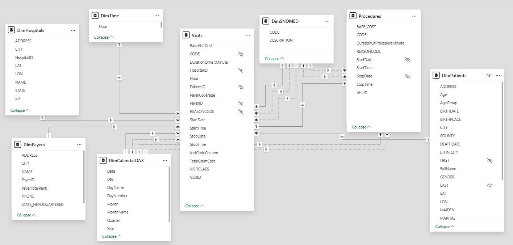
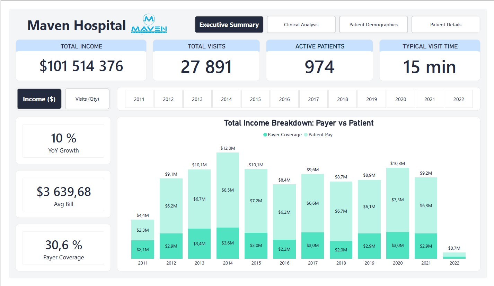
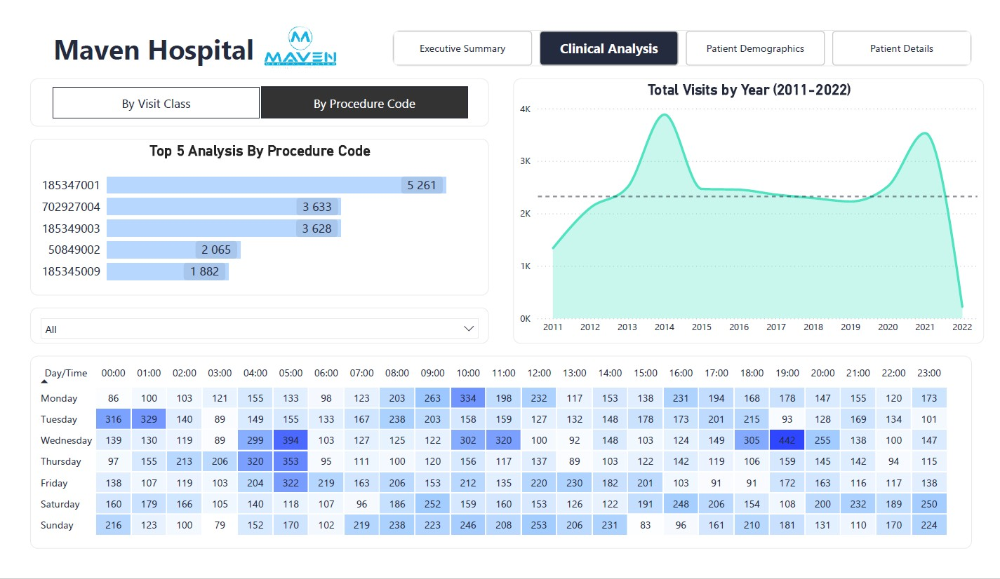
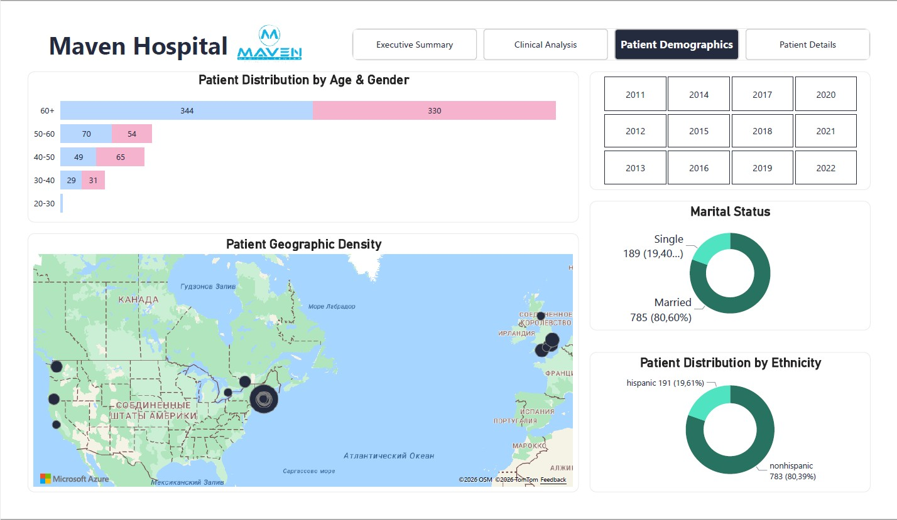
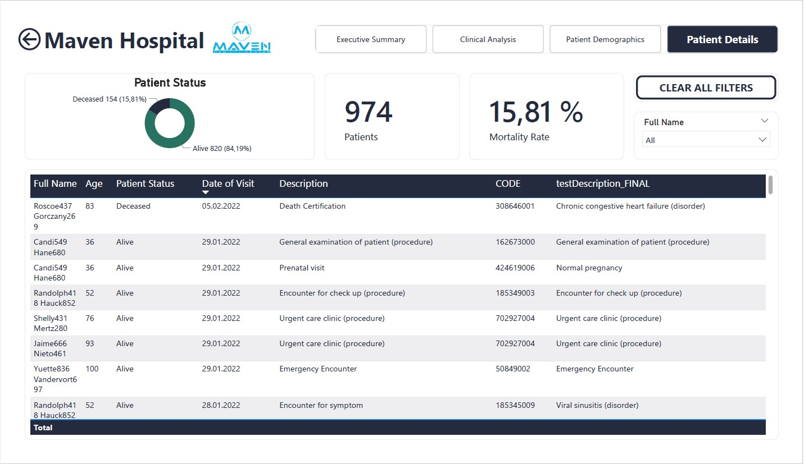

🌐 **Language:** [Ukrainian](README.ua.md) | English

# Maven Hospital Healthcare Analytics | Power BI Dashboard

## 📌 Project Overview
This project delivers an end-to-end analytical BI solution for the Maven Hospital network. The primary goal is to provide hospital executives and medical staff with an interactive tool to monitor department workload, analyze treatment costs, explore patient demographics, and evaluate overall service efficiency.

---

## 🎬 Відео-демонстрація дашборду (Video Demo)

▶️ **[Watch the full dashboard video walkthrough on YouTube](https://youtu.be/1bE5GafITwc)**

*The video demonstrates dashboard interactivity, dynamic filtering, cross-slicing, and key analytical views.*

---

## 📐 Data Model

* **Architecture:** Built using a **Star Schema** design.
* **Relationships:** Configured unidirectional **1-to-many** relationships connecting dimension tables to central fact tables.
* **Optimization:** Integrated a dedicated Calendar table to support accurate **DAX Time Intelligence** calculations.

---

## 📸 Dashboard Structure & Pages

### 1. Executive Summary

* **Core KPIs:** High-level operational and financial performance metrics.
* **Insurance Coverage Analysis:** Breakdown of treatment costs and payouts between patients and insurance providers.
* **Gender Attendance Trends:** Patient visit dynamics and volumes segmented by gender.

---

### 2. Clinical Analysis

* **Procedures & Diagnoses:** Analysis of the most frequent medical tests, diagnoses, and reasons for visits.
* **Visit Heatmap ("Visit Calendar"):** Matrix heatmap highlighting clinic workload across days of the week and years.
* **Historical Visit Trends (2011–2022):** Interactive drill-down matrix spanning years, quarters, and months.

---

### 3. Patient Demographics

* **Socio-Demographic Profile:** Distribution of patients by age groups, race/ethnicity, and marital status.
* **Geographic & Social Context:** Insights into patient structure to help optimize the hospital's social and healthcare programs.

---

### 4. Patient Details

* **Mortality Metrics:** Key KPIs tracking total patient count, status (alive/deceased), and mortality rate (%).
* **Comprehensive Visit Log:** Detailed table listing individual patient records, visit dates, and supporting clinical information.

---

## 🛠 Tech Stack
* **BI Tool:** Power BI Desktop
* **ETL / Data Transformation:** Power Query (M-Language)
* **Data Modeling:** Star Schema, 1-to-many relationships
* **Analytics & Calculations:** DAX (Time Intelligence, `CALCULATE`, `SUMX`, Filter Contexts)
* **Data Visualization & UX:** Custom Tooltips, Bookmarks, Page Navigation, Cross-filtering, Matrix Drill-through

---

## 📁 Repository Structure
* `Maven_Hospital_Analytics.pbix` — Main Power BI Desktop report file.
* `data/` — Raw input datasets (CSV/Excel).
* `screenshots/` — High-resolution screenshots of dashboard pages and the data model.
* `README.md` / `README.ua.md` — Project documentation and analytical insights.

---

## 📊 Key Insights & Business Recommendations
* **Financial & Insurance Structure:** Generated **$101.5M** in total revenue across **27,891** visits (**$3,639.68** average bill, **10% YoY** growth). Insurance payers cover only **30.6%** of total costs, highlighting a heavy out-of-pocket burden on patients and an opportunity to expand insurance partnerships.
* **Peak Workload Optimization:** Heatmap analysis pinpointed severe traffic spikes on **Wednesdays at 19:00 (442 visits)** and early mornings on **Wednesdays (394)** and **Thursdays (353) at 05:00**. Reallocating staff shifts to these peak windows helps maintain the **15-minute** average visit time and prevents bottlenecks.
* **Patient Demographics & Care Focus:** Patients aged **60+** represent **~69%** (674 out of 974) of the active patient base, with an overall mortality rate of **15.81%**. Prioritizing preventive care and chronic condition management for seniors will have the highest impact on clinical outcomes.
